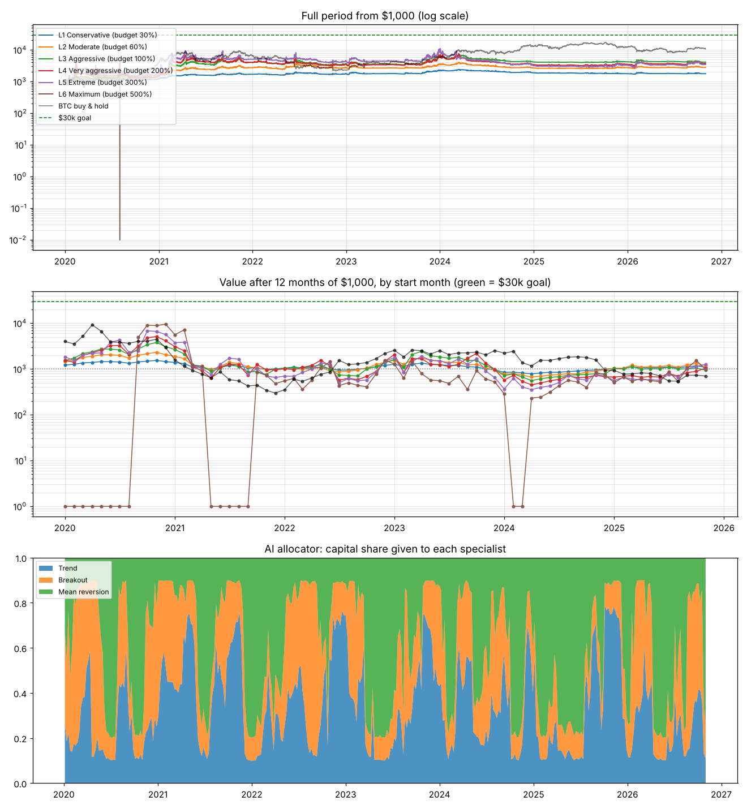

# Adaptive Regime Bot: backtest results

BTC, ETH, SOL, BNB perpetuals · 4-hour bars · $1,000 start · 0.05%/side costs + actual Binance funding · liquidation modelled · **goal: $30,000 in 12 months**

## 1. Rolling 12-month windows: how often was the $30k goal reached?

71 windows, one starting on the 1st of every month from 2020-01-01 to 2025-11-01, each starting with a fresh $1,000.

| Risk level | Realised vol (full period) | Reached $30k | Ended above $1,000 | Lost > 50% | Lost > 90% or liquidated | Median end value | Best window | Worst window |
|---|---|---|---|---|---|---|---|---|
| L1 Conservative (budget 30%) | 15% | **0%** (0/71) | 75% | 0% | 0% | $1,095 | $1,540 (from 2020-11-01) | $786 (from 2024-04-01) |
| L2 Moderate (budget 60%) | 26% | **0%** (0/71) | 70% | 0% | 0% | $1,132 | $2,314 (from 2020-11-01) | $668 (from 2024-04-01) |
| L3 Aggressive (budget 100%) | 37% | **0%** (0/71) | 63% | 0% | 0% | $1,078 | $3,792 (from 2020-11-01) | $558 (from 2024-04-01) |
| L4 Very aggressive (budget 200%) | 55% | **0%** (0/71) | 51% | 3% | 0% | $1,011 | $5,111 (from 2020-11-01) | $450 (from 2024-04-01) |
| L5 Extreme (budget 300%) | 68% | **0%** (0/71) | 51% | 8% | 0% | $1,000 | $6,826 (from 2020-10-01) | $355 (from 2024-04-01) |
| L6 Maximum (budget 500%) | 193% | **0%** (0/71) | 21% | 41% | 21% | $553 | $9,570 (from 2020-12-01) | $0.00 (from 2020-01-01) |
| BTC buy & hold | ~60% | **0%** (0/71) | 61% | 7% | 0% | $1,545 | $9,223 (from 2020-04-01) | $299 (from 2021-12-01) |

## 2. Calendar years (fresh $1,000 every 1 January)

| Year | L1 Conservative (budget 30%) | L2 Moderate (budget 60%) | L3 Aggressive (budget 100%) | L4 Very aggressive (budget 200%) | L5 Extreme (budget 300%) | L6 Maximum (budget 500%) | BTC buy & hold |
|---|---|---|---|---|---|---|---|
| 2020 | $1,221 | $1,457 | $1,533 | $1,555 | $1,847 | $0.00 (liquidated) | $4,003 |
| 2021 | $1,390 | $1,890 | $2,660 | $3,087 | $3,763 | $5,613 | $1,579 |
| 2022 | $1,040 | $1,001 | $1,043 | $1,011 | $702 | $553 | $353 |
| 2023 | $1,267 | $1,561 | $1,615 | $2,075 | $1,767 | $1,284 | $2,558 |
| 2024 | $844 | $770 | $719 | $575 | $366 | $288 | $2,211 |
| 2025 | $1,025 | $1,031 | $1,026 | $666 | $561 | $504 | $934 |
| 2026 (Jan-Oct) | $1,044 | $1,073 | $940 | $974 | $922 | $1,130 | $883 |

## 3. Full period, 1 Jan 2020 to 31 Oct 2026 (one $1,000 account, never topped up)

| Risk level | Final value | CAGR | Realised vol | Max drawdown | Sharpe | Avg leverage | Max leverage | Liquidated | Fees paid | Funding paid |
|---|---|---|---|---|---|---|---|---|---|---|
| L1 Conservative (budget 30%) | $1,774 | +8.8% | 15% | -29.1% | 0.64 | 0.21x | 0.9x | no | $198 | $277 |
| L2 Moderate (budget 60%) | $2,799 | +16.3% | 26% | -36.7% | 0.71 | 0.34x | 1.7x | no | $448 | $721 |
| L3 Aggressive (budget 100%) | $4,131 | +23.1% | 37% | -45.8% | 0.74 | 0.44x | 2.1x | no | $867 | $1,543 |
| L4 Very aggressive (budget 200%) | $3,735 | +21.3% | 55% | -58.8% | 0.63 | 0.59x | 3.6x | no | $1,198 | $2,730 |
| L5 Extreme (budget 300%) | $3,472 | +20.0% | 68% | -75.2% | 0.63 | 0.74x | 5.3x | no | $1,795 | $4,221 |
| L6 Maximum (budget 500%) | $0.00 | -100.0% | 193% | -100.0% | 0.89 | 1.35x | 8.9x | yes | $174 | $800 |
| BTC buy & hold | $10,738 | +41.6% | ~60% | -77.0% | - | 1.00x | 1.0x | no | - | - |

## 4. How the bot adapted

Share of time each asset spent in each regime (2020-2026):

| Asset | Bull trend | Range | Bear trend |
|---|---|---|---|
| BTCUSDT | 50% | 11% | 38% |
| ETHUSDT | 49% | 14% | 38% |
| SOLUSDT | 44% | 13% | 43% |
| BNBUSDT | 51% | 13% | 36% |

Average AI-allocator weight on each specialist, by year:

| Year | Trend | Breakout | Mean reversion |
|---|---|---|---|
| 2020 | 24% | 39% | 37% |
| 2021 | 45% | 27% | 28% |
| 2022 | 36% | 31% | 34% |
| 2023 | 34% | 25% | 41% |
| 2024 | 33% | 26% | 41% |
| 2025 | 34% | 14% | 52% |
| 2026 | 24% | 32% | 44% |

