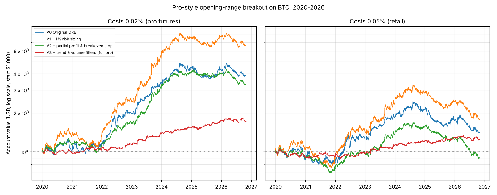

# Pro-style opening-range breakout: BTC 1-minute data, Jan 2020 to Oct 2026

Start capital $1,000. One trade per weekday max. Rules fixed before testing (see `pro_orb.py`). Cost = fee + slippage per side, on the notional traded.

## Final value of $1,000, by variant and cost level

| Variant | Trades | 0% (raw edge) | 0.01% (pro / maker rebates) | 0.02% (pro futures) | 0.05% (retail) |
|---|---|---|---|---|---|
| V0 Original ORB | 1,686 | $7,579 | $5,412 | $3,864 | $1,406 |
| V1 + 1% risk sizing | 1,686 | $15,575 | $10,088 | $6,533 | $1,773 |
| V2 + partial profit & breakeven stop | 1,686 | $7,940 | $5,142 | $3,330 | $903 |
| V3 + trend & volume filters (full pro) | 432 | $2,154 | $1,930 | $1,729 | $1,242 |

## Detail at 0.02% (pro futures) costs

| Variant | CAGR | Max drawdown | Sharpe | Win rate | Profit factor | Avg leverage |
|---|---|---|---|---|---|---|
| V0 Original ORB | +21.9% | -25.1% | 0.94 | 42.2% | 1.18 | 1.0x |
| V1 + 1% risk sizing | +31.6% | -28.9% | 1.15 | 42.2% | 1.24 | 1.3x |
| V2 + partial profit & breakeven stop | +19.3% | -24.2% | 1.05 | 53.1% | 1.18 | 1.3x |
| V3 + trend & volume filters (full pro) | +8.3% | -10.1% | 0.89 | 54.2% | 1.33 | 1.3x |

## Year by year (fresh $1,000 each 1 January)

**0.02% (pro futures) costs**

| Variant | 2020 | 2021 | 2022 | 2023 | 2024 | 2025 | 2026 |
|---|---|---|---|---|---|---|---|
| V0 Original ORB | $1,027 | $1,123 | $1,703 | $1,713 | $1,330 | $950 | $909 |
| V1 + 1% risk sizing | $1,341 | $1,053 | $1,739 | $2,175 | $1,418 | $1,015 | $849 |
| V2 + partial profit & breakeven stop | $1,134 | $1,004 | $1,450 | $1,859 | $1,349 | $959 | $838 |
| V3 + trend & volume filters (full pro) | $978 | $1,105 | $1,052 | $1,220 | $1,124 | $1,117 | $992 |

**0.05% (retail) costs**

| Variant | 2020 | 2021 | 2022 | 2023 | 2024 | 2025 | 2026 |
|---|---|---|---|---|---|---|---|
| V0 Original ORB | $886 | $967 | $1,475 | $1,481 | $1,142 | $817 | $804 |
| V1 + 1% risk sizing | $1,060 | $901 | $1,502 | $1,656 | $1,206 | $848 | $731 |
| V2 + partial profit & breakeven stop | $896 | $859 | $1,252 | $1,415 | $1,146 | $800 | $721 |
| V3 + trend & volume filters (full pro) | $908 | $1,059 | $1,010 | $1,156 | $1,085 | $1,062 | $961 |

## Stability check for the full pro version (0.02% costs)

| Period | Trades | Win rate | Profit factor | Annual return |
|---|---|---|---|---|
| 2020-2023 | 261 | 52.9% | 1.31 | +8.7% |
| 2024-Oct 2026 | 171 | 56.1% | 1.35 | +8.2% |

