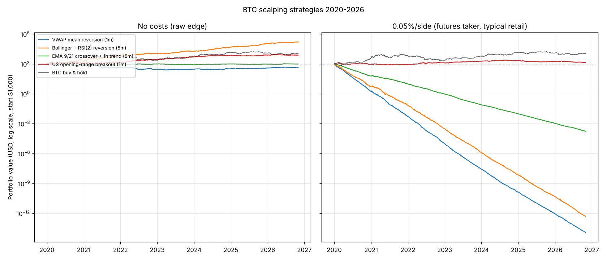

# BTC scalping backtest: 4 strategies

BTC/USDT 1-minute data (Binance), **01 Jan 2020 to 31 Oct 2026** · Start capital **$1,000** · 100% of equity per trade, no leverage, long and short · Entry at next bar open · stop-loss hit first if stop and target touch in the same bar.

Benchmark, BTC buy & hold: **$10,782** (CAGR +41.6%, max drawdown -76.6%, Sharpe 0.89).

## Final value of $1,000 under each cost level

| Strategy | No costs (raw edge) | 0.02%/side (maker / VIP, optimistic) | 0.05%/side (futures taker, typical retail) | 0.10%/side (spot taker, standard retail) | Break-even cost per side |
|---|---|---|---|---|---|
| VWAP mean reversion (1m) | $451 | < $0.01 | < $0.01 | < $0.01 | none (loses before costs) |
| Bollinger + RSI(2) reversion (5m) | $152,049 | $0.01 | < $0.01 | < $0.01 | 0.006% |
| EMA 9/21 crossover + 1h trend (5m) | $992 | $1.97 | < $0.01 | < $0.01 | none (loses before costs) |
| US opening-range breakout (1m) | $7,588 | $3,865 | $1,405 | $260 | 0.060% |

## Detail at realistic costs (0.05%/side (futures taker, typical retail))

| Strategy | Final value | Total return | CAGR | Max drawdown | Sharpe | Trades | Trades/day | Win rate | Avg trade (net) | Profit factor |
|---|---|---|---|---|---|---|---|---|---|---|
| VWAP mean reversion (1m) | < $0.01 | -100.0% | -99.7% | -100.0% | -22.41 | 38,167 | 15.3 | 28.1% | -0.101% | 0.46 |
| Bollinger + RSI(2) reversion (5m) | < $0.01 | -100.0% | -99.4% | -100.0% | -13.16 | 40,356 | 16.2 | 41.2% | -0.086% | 0.64 |
| EMA 9/21 crossover + 1h trend (5m) | < $0.01 | -100.0% | -89.7% | -100.0% | -13.37 | 15,547 | 6.2 | 30.8% | -0.099% | 0.49 |
| US opening-range breakout (1m) | $1,405 | +40.5% | +5.1% | -42.8% | 0.33 | 1,686 | 0.7 | 40.5% | +0.031% | 1.06 |
| BTC buy & hold | $10,782 | +978.2% | +41.6% | -76.6% | 0.89 | 1 | - | - | - | - |

## Raw edge before costs

| Strategy | Final value | CAGR | Win rate | Avg trade (gross) | Profit factor | Max drawdown |
|---|---|---|---|---|---|---|
| VWAP mean reversion (1m) | $451 | -11.0% | 32.8% | -0.001% | 0.99 | -75.9% |
| Bollinger + RSI(2) reversion (5m) | $152,049 | +108.7% | 44.4% | +0.014% | 1.08 | -34.8% |
| EMA 9/21 crossover + 1h trend (5m) | $992 | -0.1% | 32.6% | +0.001% | 1.00 | -41.1% |
| US opening-range breakout (1m) | $7,588 | +34.5% | 42.7% | +0.131% | 1.28 | -18.9% |

## Year-by-year returns at realistic costs (0.05%/side (futures taker, typical retail))

| Year | VWAP mean reversion (1m) | Bollinger + RSI(2) reversion (5m) | EMA 9/21 crossover + 1h trend (5m) | US opening-range breakout (1m) | BTC buy & hold |
|---|---|---|---|---|---|
| 2020 | -99.8% | -99.5% | -93.9% | -11.4% | +302.0% |
| 2021 | -99.7% | -98.7% | -83.6% | -3.2% | +59.8% |
| 2022 | -99.8% | -99.5% | -90.4% | +47.5% | -64.2% |
| 2023 | -99.7% | -99.6% | -91.9% | +48.0% | +155.6% |
| 2024 | -99.5% | -99.4% | -87.5% | +14.2% | +121.3% |
| 2025 | -99.3% | -99.3% | -89.0% | -18.3% | -6.3% |
| 2026 (to 31 Oct) | -98.7% | -99.1% | -83.6% | -19.6% | -11.5% |

