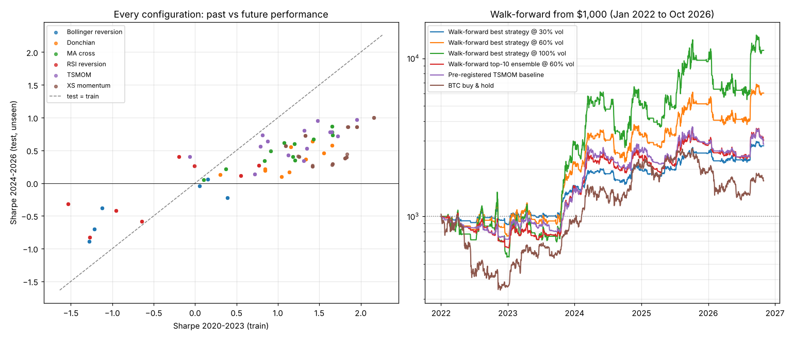

# Part 1: honest strategy search

**180 strategy configurations** (6 families x parameters x long-only/long-short x 3 risk levels) on BTC, ETH, SOL, BNB perpetuals, daily bars, 0.05%/side costs, real funding, leverage caps (3x/asset, 5x total), liquidation modelled.

## A. Train 2020-2023, test Jan 2024-Oct 2026 (unseen)

| Strategy | Train CAGR | Train Sharpe | Test CAGR | Test Sharpe | Test max DD |
|---|---|---|---|---|---|
| Best train CAGR (naive pick) XS momentum (lookback=30, top=2, long-only) @ 100% vol | +315.1% | 2.16 | +62.5% | 1.00 | -58.2% |
| Best train Sharpe XS momentum (lookback=30, top=2, long-only) @ 30% vol | +64.3% | 2.16 | +23.3% | 1.00 | -20.5% |
| Top-10 train-Sharpe ensemble | +131.1% | 2.12 | +39.9% | 0.99 | -37.0% |
| Pre-registered TSMOM baseline | +78.8% | 1.70 | +27.3% | 0.84 | -35.6% |
| BTC buy & hold | +55.7% | 1.00 | +23.9% | 0.69 | -53.0% |

**Overfitting diagnostics**

- Rank correlation between train and test Sharpe across the 60 unique strategies: **0.78** (1.0 = past ranking perfectly predicts future ranking; 0 = no relation).
- 83% of strategies had a lower Sharpe in the test period. Median Sharpe: 1.13 train vs 0.40 test.
- Top-10% strategies by train Sharpe: average train Sharpe 1.92, test Sharpe 0.74.
- **Deflated Sharpe Ratio** of the best-train-Sharpe pick: **50%** probability its true Sharpe is above zero after accounting for 60 independent strategy trials (Bailey & Lopez de Prado, 2014). Above 95% would count as significant.
- Liquidated configurations: 0.

## B. Walk-forward (each year chosen using only earlier data)

| Year | Strategy the bot chose | Its Sharpe up to that point |
|---|---|---|
| 2022 | XS momentum (lookback=30, top=2, long-only) | 3.16 |
| 2023 | XS momentum (lookback=30, top=2, long-only) | 2.08 |
| 2024 | XS momentum (lookback=30, top=2, long-only) | 2.16 |
| 2025 | XS momentum (lookback=30, top=2, long-only) | 1.96 |
| 2026 | XS momentum (lookback=30, top=2, long-only) | 1.85 |

Value of a fresh $1,000 each year:

| Strategy | 2022 | 2023 | 2024 | 2025 | 2026 (to Oct) | 2022-26 CAGR | Sharpe | Max DD |
|---|---|---|---|---|---|---|---|---|
| Walk-forward best strategy @ 30% vol | $889 | $1,739 | $1,270 | $1,274 | $1,118 | +23.7% | 1.03 | -23.2% |
| Walk-forward best strategy @ 60% vol | $753 | $2,857 | $1,527 | $1,549 | $1,185 | +45.0% | 1.03 | -41.9% |
| Walk-forward best strategy @ 100% vol | $558 | $5,085 | $1,795 | $1,868 | $1,180 | +65.0% | 1.03 | -61.3% |
| Walk-forward top-10 ensemble @ 60% vol | $637 | $2,370 | $1,561 | $1,192 | $1,081 | +25.8% | 0.79 | -39.9% |
| Pre-registered TSMOM baseline | $717 | $2,015 | $1,782 | $1,117 | $995 | +24.3% | 0.80 | -35.6% |
| BTC buy & hold | $358 | $2,556 | $2,213 | $937 | $885 | +11.3% | 0.46 | -66.9% |

## C. Against the $30k goal

- Calendar-year outcomes tested: 1,260 (180 configs x 7 years).
- Outcomes where a fresh $1,000 reached $30,000: **0**.
- Single best config-year anywhere in the search: **$21,093** (XS momentum (lookback=14, top=1, long-only) @ 100% vol, 2020), found only by looking back.

