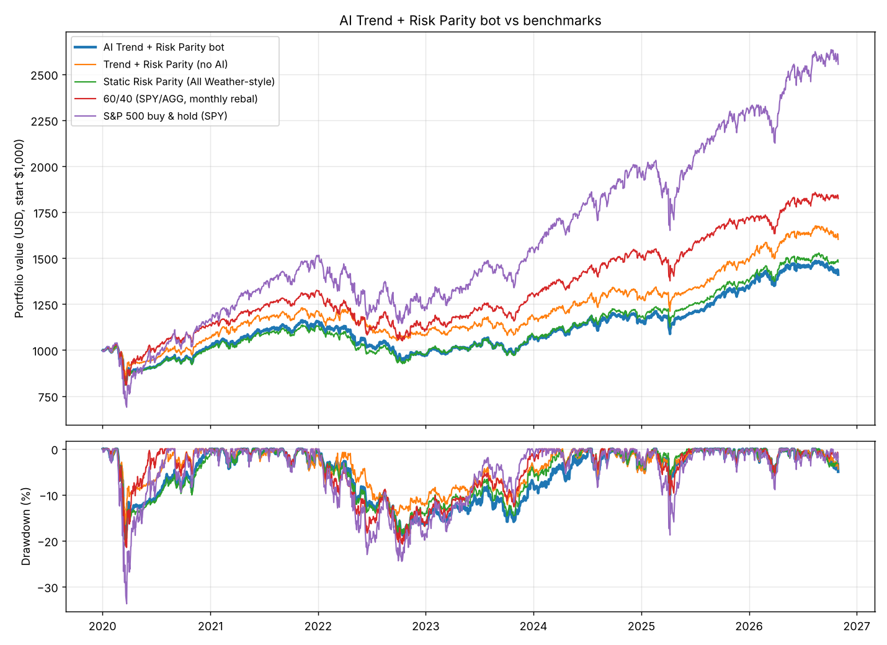

# Backtest results: AI Trend + Risk Parity bot

Period: **2020-01-02 to 2026-10-30** · Initial capital: **$1,000** · Monthly rebalance, next-day execution, 10 bps cost per trade side, no leverage.

## Summary

| Strategy | Final value | Total return | CAGR | Volatility | Sharpe | Sortino | Max drawdown | Calmar |
|---|---|---|---|---|---|---|---|---|
| AI Trend + Risk Parity bot | $1,410 | +41.0% | +5.2% | 10.4% | 0.28 | 0.34 | -19.7% | 0.26 |
| Trend + Risk Parity (no AI) | $1,602 | +60.2% | +7.1% | 10.1% | 0.47 | 0.59 | -16.4% | 0.43 |
| Static Risk Parity (All Weather-style) | $1,479 | +47.9% | +5.9% | 10.3% | 0.35 | 0.42 | -20.9% | 0.28 |
| 60/40 (SPY/AGG, monthly rebal) | $1,823 | +82.3% | +9.2% | 12.5% | 0.55 | 0.69 | -21.5% | 0.43 |
| S&P 500 buy & hold (SPY) | $2,554 | +155.4% | +14.7% | 20.0% | 0.65 | 0.81 | -33.7% | 0.44 |

## Year-by-year returns

| Year | AI Trend + Risk Parity bot | Trend + Risk Parity (no AI) | Static Risk Parity (All Weather-style) | 60/40 (SPY/AGG, monthly rebal) | S&P 500 buy & hold (SPY) |
|---|---|---|---|---|---|
| 2020 | +2.1% | +7.0% | +1.2% | +14.1% | +17.0% |
| 2021 | +13.0% | +13.0% | +11.7% | +15.7% | +28.7% |
| 2022 | -15.8% | -10.5% | -13.7% | -15.9% | -18.2% |
| 2023 | +10.8% | +9.6% | +11.2% | +17.7% | +26.2% |
| 2024 | +6.9% | +7.7% | +8.7% | +15.0% | +24.9% |
| 2025 | +15.9% | +15.9% | +16.2% | +13.5% | +17.7% |
| 2026 (to 30 Oct) | +5.7% | +8.2% | +8.0% | +6.8% | +11.7% |

## Value of $1,000 at each year end

| Date | AI Trend + Risk Parity bot | Trend + Risk Parity (no AI) | Static Risk Parity (All Weather-style) | 60/40 (SPY/AGG, monthly rebal) | S&P 500 buy & hold (SPY) |
|---|---|---|---|---|---|
| 2020-12-31 | $1,021 | $1,070 | $1,012 | $1,141 | $1,170 |
| 2021-12-31 | $1,154 | $1,209 | $1,130 | $1,320 | $1,507 |
| 2022-12-30 | $972 | $1,083 | $975 | $1,111 | $1,233 |
| 2023-12-29 | $1,077 | $1,186 | $1,085 | $1,307 | $1,555 |
| 2024-12-31 | $1,152 | $1,278 | $1,179 | $1,504 | $1,943 |
| 2025-12-31 | $1,334 | $1,480 | $1,369 | $1,707 | $2,287 |
| 2026-10-30 | $1,410 | $1,602 | $1,479 | $1,823 | $2,554 |

## Risk and trading statistics

| Metric | AI Trend + Risk Parity bot | Trend + Risk Parity (no AI) | Static Risk Parity (All Weather-style) | 60/40 (SPY/AGG, monthly rebal) | S&P 500 buy & hold (SPY) |
|---|---|---|---|---|---|
| % months positive | 63% | 62% | 62% | 64% | 64% |
| Best month | +6.5% | +6.4% | +6.6% | +8.6% | +12.7% |
| Worst month | -6.0% | -3.9% | -7.6% | -7.6% | -12.5% |
| Avg risky exposure | 92% | 87% | 93% | 100% | 100% |
| Annual turnover | 2.4x | 2.7x | 0.9x | 0.2x | 0.1x |

## Bot's current target allocation (signal of 2026-10-30)

| ETF | Weight |
|---|---|
| SPY | 18.0% |
| DBC | 16.4% |
| IEF | 15.5% |
| EFA | 13.4% |
| IWM | 12.1% |
| VNQ | 8.1% |
| QQQ | 7.2% |
| TLT | 4.2% |
| EEM | 2.9% |
| GLD | 2.2% |

